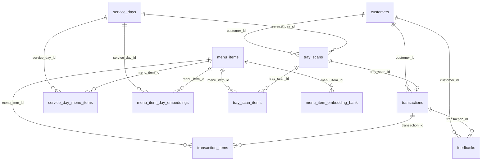

# Database Schema — Tecdia Tray Track

PostgreSQL 15+, database name `tecdia_tray_track`, extension `pgcrypto` (for `gen_random_uuid()`).

Connection via `src/lib/db.ts` — a connection pool (max 10, idle timeout 30s, connection timeout 5s).

**Migration order:** `schema.sql` → `002` → `003` → `004` → `005` → `006` → `007` → `008` → `009` → `010`

---

## Table of Contents

1. [Entity Relationship Diagram](#1-entity-relationship-diagram)
2. [Core Tables](#2-core-tables)
3. [Transaction Tables](#3-transaction-tables)
4. [ML / Embedding Tables](#4-ml--embedding-tables)
5. [Index Summary](#5-index-summary)
6. [Foreign Key Summary](#6-foreign-key-summary)
7. [Migration History](#7-migration-history)
8. [Seed Data](#8-seed-data)
9. [Application Usage Map](#9-application-usage-map)

---

## 1. Entity Relationship Diagram



---

## 2. Core Tables

### `customers`

Employee cafeteria accounts. Created on signup. Stores hashed passwords and profile fields.

| Column | Type | Nullable | Default | Notes |
|--------|------|----------|---------|-------|
| `id` | UUID | NOT NULL | `gen_random_uuid()` | PRIMARY KEY |
| `employee_code` | TEXT | NOT NULL | — | UNIQUE; backfilled in migration 004 |
| `email` | TEXT | NOT NULL | — | UNIQUE |
| `full_name` | TEXT | NOT NULL | — | |
| `department` | TEXT | NOT NULL | — | Backfilled to `'General'` in migration 004 |
| `password_hash` | TEXT | NOT NULL | — | |
| `password_salt` | TEXT | NOT NULL | — | |
| `is_active` | BOOLEAN | NOT NULL | `TRUE` | |
| `created_at` | TIMESTAMPTZ | NOT NULL | `NOW()` | |
| `updated_at` | TIMESTAMPTZ | NOT NULL | `NOW()` | |

**Used by:** `customer-auth.ts`, `customer-profile.ts`, `customer-activity-db.ts`, `auth.ts`

---

### `admin_users`

Legacy admin table. Not actively used by kiosk UI (use `staff_users` instead).

| Column | Type | Nullable | Default | Notes |
|--------|------|----------|---------|-------|
| `id` | UUID | NOT NULL | `gen_random_uuid()` | PRIMARY KEY |
| `email` | TEXT | NOT NULL | — | UNIQUE |
| `full_name` | TEXT | NOT NULL | — | |
| `pin_hash` | TEXT | NOT NULL | — | |
| `pin_salt` | TEXT | NOT NULL | — | |
| `role` | TEXT | NOT NULL | `'admin'` | |
| `created_at` | TIMESTAMPTZ | NOT NULL | `NOW()` | |

**Used by:** not actively used

---

### `staff_users`

Admin panel users — admins and cashiers with role-based access.

| Column | Type | Nullable | Default | Notes |
|--------|------|----------|---------|-------|
| `id` | UUID | NOT NULL | `gen_random_uuid()` | PRIMARY KEY |
| `user_code` | TEXT | NOT NULL | — | UNIQUE |
| `full_name` | TEXT | NOT NULL | — | |
| `description` | TEXT | NOT NULL | `''` | |
| `email` | TEXT | NOT NULL | — | UNIQUE |
| `role` | TEXT | NOT NULL | — | CHECK `IN ('admin', 'cashier')` |
| `shift` | TEXT | NOT NULL | `''` | |
| `status` | TEXT | NOT NULL | `'active'` | CHECK `IN ('active', 'invited', 'suspended')` |
| `created_at` | TIMESTAMPTZ | NOT NULL | `NOW()` | |
| `updated_at` | TIMESTAMPTZ | NOT NULL | `NOW()` | |

**Indexes:** `idx_staff_users_role`, `idx_staff_users_status`

**Used by:** `admin-users-db.ts`

---

### `menu_items`

Master dish catalog. Every dish served across all service days is referenced here.

| Column | Type | Nullable | Default | Notes |
|--------|------|----------|---------|-------|
| `id` | UUID | NOT NULL | `gen_random_uuid()` | PRIMARY KEY |
| `code` | TEXT | NOT NULL | — | UNIQUE; auto-generated on insert |
| `name` | TEXT | NOT NULL | — | Lowercase dish name |
| `category` | TEXT | NOT NULL | — | e.g. `'Main Course'`, `'Soup'` |
| `base_price` | NUMERIC(10,2) | NOT NULL | — | CHECK >= 0 |
| `calories` | INTEGER | YES | — | CHECK >= 0 OR NULL (made nullable by migration 002) |
| `image_url` | TEXT | YES | — | |
| `is_active` | BOOLEAN | NOT NULL | `TRUE` | |
| `reference_embedding` | JSONB | YES | — | Added by migration 008 |
| `reference_model_version` | TEXT | YES | — | Added by migration 008 |
| `created_at` | TIMESTAMPTZ | NOT NULL | `NOW()` | |

**Partial index:** `idx_menu_items_has_reference_embedding` WHERE `reference_embedding IS NOT NULL`

**Used by:** `today-menu-db.ts`, `embeddings-db.ts`, `embedding-bank.ts`

---

### `service_days`

Date-based grouping for daily menus. One row per service date.

| Column | Type | Nullable | Default | Notes |
|--------|------|----------|---------|-------|
| `id` | UUID | NOT NULL | `gen_random_uuid()` | PRIMARY KEY |
| `service_date` | DATE | NOT NULL | — | UNIQUE |
| `meal_window` | TEXT | YES | — | |
| `created_at` | TIMESTAMPTZ | NOT NULL | `NOW()` | |

**Used by:** `today-menu-db.ts`

---

### `service_day_menu_items`

Links menu items to a service day. Defines what's available today and at what price.

| Column | Type | Nullable | Default | Notes |
|--------|------|----------|---------|-------|
| `id` | UUID | NOT NULL | `gen_random_uuid()` | PRIMARY KEY |
| `service_day_id` | UUID | NOT NULL | — | FK → `service_days(id)` ON DELETE CASCADE |
| `menu_item_id` | UUID | NOT NULL | — | FK → `menu_items(id)` ON DELETE RESTRICT |
| `override_price` | NUMERIC(10,2) | YES | — | CHECK >= 0; overrides `menu_items.base_price` |
| `available` | BOOLEAN | NOT NULL | `TRUE` | |
| | | | | UNIQUE `(service_day_id, menu_item_id)` |

**Used by:** `today-menu-db.ts`

---

## 3. Transaction Tables

### `tray_scans`

A scan session — one photo taken, potentially multiple items detected.

| Column | Type | Nullable | Default | Notes |
|--------|------|----------|---------|-------|
| `id` | UUID | NOT NULL | `gen_random_uuid()` | PRIMARY KEY |
| `customer_id` | UUID | NOT NULL | — | FK → `customers(id)` ON DELETE RESTRICT |
| `service_day_id` | UUID | YES | — | FK → `service_days(id)` ON DELETE SET NULL |
| `scan_source` | TEXT | NOT NULL | `'demo'` | |
| `status` | TEXT | NOT NULL | `'completed'` | |
| `scanned_at` | TIMESTAMPTZ | NOT NULL | `NOW()` | |

**Index:** `idx_tray_scans_customer_id`

**Used by:** `customer-activity-db.ts`

---

### `tray_scan_items`

Individual dish detections from a tray scan.

| Column | Type | Nullable | Default | Notes |
|--------|------|----------|---------|-------|
| `id` | UUID | NOT NULL | `gen_random_uuid()` | PRIMARY KEY |
| `tray_scan_id` | UUID | NOT NULL | — | FK → `tray_scans(id)` ON DELETE CASCADE |
| `menu_item_id` | UUID | NOT NULL | — | FK → `menu_items(id)` ON DELETE RESTRICT |
| `quantity` | INTEGER | NOT NULL | `1` | CHECK > 0 |
| `unit_price` | NUMERIC(10,2) | NOT NULL | — | CHECK >= 0 |
| `confidence` | NUMERIC(5,4) | YES | — | CHECK 0–1; CLIP match score |

**Used by:** not directly used in queries (written during scan, read via transaction join)

---

### `transactions`

Payment records. Created at checkout.

| Column | Type | Nullable | Default | Notes |
|--------|------|----------|---------|-------|
| `id` | UUID | NOT NULL | `gen_random_uuid()` | PRIMARY KEY |
| `customer_id` | UUID | NOT NULL | — | FK → `customers(id)` ON DELETE RESTRICT |
| `tray_scan_id` | UUID | YES | — | FK → `tray_scans(id)` ON DELETE SET NULL |
| `subtotal` | NUMERIC(10,2) | NOT NULL | — | CHECK >= 0 |
| `tax_amount` | NUMERIC(10,2) | NOT NULL | `0` | CHECK >= 0 |
| `total_amount` | NUMERIC(10,2) | NOT NULL | — | CHECK >= 0 |
| `payment_method` | TEXT | NOT NULL | — | `'immediate'` or `'account'` |
| `payment_status` | TEXT | NOT NULL | `'pending'` | |
| `created_at` | TIMESTAMPTZ | NOT NULL | `NOW()` | |

**Indexes:** `idx_transactions_customer_id`, `idx_transactions_created_at`, `idx_transactions_payment_status_created_at`

**Used by:** `admin-transactions-db.ts`, `customer-activity-db.ts`, `admin-stats-db.ts`

---

### `transaction_items`

Line items for each transaction.

| Column | Type | Nullable | Default | Notes |
|--------|------|----------|---------|-------|
| `id` | UUID | NOT NULL | `gen_random_uuid()` | PRIMARY KEY |
| `transaction_id` | UUID | NOT NULL | — | FK → `transactions(id)` ON DELETE CASCADE |
| `menu_item_id` | UUID | YES | — | FK → `menu_items(id)` ON DELETE SET NULL |
| `item_name_snapshot` | TEXT | NOT NULL | — | Dish name at time of purchase |
| `quantity` | INTEGER | NOT NULL | — | CHECK > 0 |
| `unit_price` | NUMERIC(10,2) | NOT NULL | — | CHECK >= 0 |
| `line_total` | NUMERIC(10,2) | NOT NULL | — | CHECK >= 0 |

**Index:** `idx_transaction_items_transaction_id`

**Used by:** `admin-transactions-db.ts`

---

### `feedbacks`

Customer-submitted issue reports.

| Column | Type | Nullable | Default | Notes |
|--------|------|----------|---------|-------|
| `id` | UUID | NOT NULL | `gen_random_uuid()` | PRIMARY KEY |
| `customer_id` | UUID | NOT NULL | — | FK → `customers(id)` ON DELETE CASCADE |
| `transaction_id` | UUID | YES | — | FK → `transactions(id)` ON DELETE SET NULL |
| `issue_text` | TEXT | NOT NULL | — | |
| `created_at` | TIMESTAMPTZ | NOT NULL | `NOW()` | |

**Indexes:** `idx_feedbacks_customer_id`, `idx_feedbacks_transaction_id`

**Used by:** `admin-transactions-db.ts`, `customer-activity-db.ts`

---

## 4. ML / Embedding Tables

### `menu_item_day_embeddings`

CLIP embeddings for a specific menu item on a specific service day. Used for real-time similarity matching during tray scan.

| Column | Type | Nullable | Default | Notes |
|--------|------|----------|---------|-------|
| `id` | UUID | NOT NULL | `gen_random_uuid()` | PRIMARY KEY |
| `menu_item_id` | UUID | NOT NULL | — | FK → `menu_items(id)` ON DELETE CASCADE |
| `service_day_id` | UUID | NOT NULL | — | FK → `service_days(id)` ON DELETE CASCADE |
| `embedding` | JSONB | NOT NULL | — | 512-dim CLIP vector |
| `model_version` | TEXT | NOT NULL | `'Xenova/clip-vit-base-patch32'` | |
| `image_path` | TEXT | YES | — | Path to saved reference photo |
| `updated_at` | TIMESTAMPTZ | NOT NULL | `NOW()` | |
| | | | | UNIQUE `(menu_item_id, service_day_id)` |

**Indexes:** `idx_menu_item_day_embeddings_service_day`, `idx_menu_item_day_embeddings_menu_item`

**Used by:** `embeddings-db.ts`

---

### `menu_item_embedding_bank`

Accumulated CLIP prototype bank. Stores embeddings from admin uploads and imported training data. Persists across service days.

| Column | Type | Nullable | Default | Notes |
|--------|------|----------|---------|-------|
| `id` | UUID | NOT NULL | `gen_random_uuid()` | PRIMARY KEY |
| `menu_item_id` | UUID | YES | — | FK → `menu_items(id)` ON DELETE CASCADE; nullable after migration 010 |
| `reference_name` | TEXT | NOT NULL | — | Dish name label (added by migration 010; backfilled from `menu_items.name`) |
| `embedding` | JSONB | NOT NULL | — | 512-dim CLIP vector |
| `model_version` | TEXT | NOT NULL | — | |
| `source` | TEXT | NOT NULL | — | `'admin_upload'`, `'training_bank'`, etc. |
| `source_key` | TEXT | NOT NULL | — | Unique identifier within source |
| `created_at` | TIMESTAMPTZ | NOT NULL | `NOW()` | |
| | | | | UNIQUE `(reference_name, source, source_key)` |

**Indexes:** `idx_menu_item_embedding_bank_menu_item`, `idx_menu_item_embedding_bank_reference_name`, `idx_menu_item_embedding_bank_source`

**Used by:** `embedding-bank.ts`, `vision-bank-sync.ts`

---

### `embedding_bank_sync_state`

Tracks sync fingerprint for external vision banks (e.g. the Computer Vision training folder).

| Column | Type | Nullable | Default | Notes |
|--------|------|----------|---------|-------|
| `source` | TEXT | NOT NULL | — | PRIMARY KEY |
| `fingerprint` | TEXT | NOT NULL | — | Hash of source data |
| `prototype_count` | INTEGER | NOT NULL | `0` | |
| `synced_at` | TIMESTAMPTZ | NOT NULL | `NOW()` | |

**Used by:** `vision-bank-sync.ts`

---

## 5. Index Summary

| Index Name | Table | Column(s) | Type / Condition |
|------------|-------|-----------|------------------|
| `idx_customers_email` | customers | `email` | B-tree |
| `idx_staff_users_role` | staff_users | `role` | B-tree |
| `idx_staff_users_status` | staff_users | `status` | B-tree |
| `idx_menu_items_has_reference_embedding` | menu_items | `(reference_embedding IS NOT NULL)` | Partial; WHERE NOT NULL |
| `idx_tray_scans_customer_id` | tray_scans | `customer_id` | B-tree |
| `idx_transactions_customer_id` | transactions | `customer_id` | B-tree |
| `idx_transactions_created_at` | transactions | `created_at DESC` | B-tree descending |
| `idx_transactions_payment_status_created_at` | transactions | `(payment_status, created_at DESC)` | B-tree composite |
| `idx_transaction_items_transaction_id` | transaction_items | `transaction_id` | B-tree |
| `idx_feedbacks_customer_id` | feedbacks | `customer_id` | B-tree |
| `idx_feedbacks_transaction_id` | feedbacks | `transaction_id` | B-tree |
| `idx_menu_item_day_embeddings_service_day` | menu_item_day_embeddings | `service_day_id` | B-tree |
| `idx_menu_item_day_embeddings_menu_item` | menu_item_day_embeddings | `menu_item_id` | B-tree |
| `idx_menu_item_embedding_bank_menu_item` | menu_item_embedding_bank | `menu_item_id` | B-tree |
| `idx_menu_item_embedding_bank_reference_name` | menu_item_embedding_bank | `reference_name` | B-tree |
| `idx_menu_item_embedding_bank_source` | menu_item_embedding_bank | `source` | B-tree |

---

## 6. Foreign Key Summary

| FK Column | Parent Table | Child Table | Delete Rule |
|-----------|-------------|-------------|-------------|
| `service_day_id` | `service_days` | `service_day_menu_items` | CASCADE |
| `menu_item_id` | `menu_items` | `service_day_menu_items` | RESTRICT |
| `customer_id` | `customers` | `tray_scans` | RESTRICT |
| `service_day_id` | `service_days` | `tray_scans` | SET NULL |
| `tray_scan_id` | `tray_scans` | `tray_scan_items` | CASCADE |
| `menu_item_id` | `menu_items` | `tray_scan_items` | RESTRICT |
| `customer_id` | `customers` | `transactions` | RESTRICT |
| `tray_scan_id` | `tray_scans` | `transactions` | SET NULL |
| `transaction_id` | `transactions` | `transaction_items` | CASCADE |
| `menu_item_id` | `menu_items` | `transaction_items` | SET NULL |
| `customer_id` | `customers` | `feedbacks` | CASCADE |
| `transaction_id` | `transactions` | `feedbacks` | SET NULL |
| `menu_item_id` | `menu_items` | `menu_item_day_embeddings` | CASCADE |
| `service_day_id` | `service_days` | `menu_item_day_embeddings` | CASCADE |
| `menu_item_id` | `menu_items` | `menu_item_embedding_bank` | CASCADE (nullable) |

---

## 7. Migration History

Apply in order after `schema.sql`:

```
psql -U postgres -h localhost -d tecdia_tray_track -f db/migrations/002_menu_calories_nullable.sql
psql -U postgres -h localhost -d tecdia_tray_track -f db/migrations/003_feedbacks_table.sql
psql -U postgres -h localhost -d tecdia_tray_track -f db/migrations/004_customers_profile_fields.sql
psql -U postgres -h localhost -d tecdia_tray_track -f db/migrations/005_transactions_analytics_indexes.sql
psql -U postgres -h localhost -d tecdia_tray_track -f db/migrations/006_staff_users.sql
psql -U postgres -h localhost -d tecdia_tray_track -f db/migrations/007_menu_item_day_embeddings.sql
psql -U postgres -h localhost -d tecdia_tray_track -f db/migrations/008_menu_item_reference_embedding.sql
psql -U postgres -h localhost -d tecdia_tray_track -f db/migrations/009_menu_item_embedding_bank.sql
psql -U postgres -h localhost -d tecdia_tray_track -f db/migrations/010_embedding_bank_reference_name.sql
```

| # | File | Change |
|---|------|--------|
| 002 | `002_menu_calories_nullable.sql` | `ALTER TABLE menu_items ALTER COLUMN calories DROP NOT NULL` |
| 003 | `003_feedbacks_table.sql` | Creates `feedbacks` table (same DDL as schema.sql, idempotent) |
| 004 | `004_customers_profile_fields.sql` | Adds `employee_code TEXT` and `department TEXT`; backfills missing values from `id`; sets NOT NULL; adds UNIQUE constraint on `employee_code` |
| 005 | `005_transactions_analytics_indexes.sql` | Creates 3 indexes on transactions (idempotent) |
| 006 | `006_staff_users.sql` | Creates `staff_users` table (same as schema.sql, idempotent) |
| 007 | `007_menu_item_day_embeddings.sql` | Creates `menu_item_day_embeddings` table with FKs and UNIQUE |
| 008 | `008_menu_item_reference_embedding.sql` | Adds `reference_embedding JSONB` and `reference_model_version TEXT` to `menu_items`; creates partial index |
| 009 | `009_menu_item_embedding_bank.sql` | Creates `menu_item_embedding_bank` + `embedding_bank_sync_state` tables |
| 010 | `010_embedding_bank_reference_name.sql` | Adds nullable `reference_name`, backfills from `menu_items.name`, sets NOT NULL; makes `menu_item_id` nullable; replaces UNIQUE constraint |

---

## 8. Seed Data

File: `db/seed_today_menu_example.sql`

Creates:
1. A `service_days` row for `CURRENT_DATE` (ON CONFLICT DO NOTHING)
2. A sample menu item `EXAMPLE-001` → `'Example Thali'` in `menu_items` (upserts by code)
3. Links item to today via `service_day_menu_items` (ON CONFLICT DO UPDATE)

Run:
```powershell
psql -U postgres -h localhost -d tecdia_tray_track -f db/seed_today_menu_example.sql
```

---

## 9. Application Usage Map

| Table | Read By | Written By |
|-------|---------|------------|
| `customers` | `customer-auth.ts`, `customer-profile.ts`, `customer-activity-db.ts` | `customer-auth.ts` |
| `admin_users` | (legacy, not actively used) | — |
| `staff_users` | `admin-users-db.ts` | `admin-users-db.ts` |
| `menu_items` | `today-menu-db.ts`, `embeddings-db.ts`, `embedding-bank.ts` | `today-menu-db.ts` |
| `service_days` | `today-menu-db.ts` | `today-menu-db.ts` |
| `service_day_menu_items` | `today-menu-db.ts` | `today-menu-db.ts` |
| `tray_scans` | `customer-activity-db.ts` | `customer-activity-db.ts` |
| `tray_scan_items` | (read via transaction joins) | `customer-activity-db.ts` |
| `transactions` | `admin-transactions-db.ts`, `customer-activity-db.ts`, `admin-stats-db.ts` | `customer-activity-db.ts` |
| `transaction_items` | `admin-transactions-db.ts` | `customer-activity-db.ts` |
| `feedbacks` | `admin-transactions-db.ts` | `customer-activity-db.ts` |
| `menu_item_day_embeddings` | `embeddings-db.ts` | `embeddings-db.ts`, `menu-reference-rebuild.ts` |
| `menu_item_embedding_bank` | `embedding-bank.ts`, `vision-bank-sync.ts` | `embedding-bank.ts`, `vision-bank-sync.ts` |
| `embedding_bank_sync_state` | `vision-bank-sync.ts` | `vision-bank-sync.ts` |

---

## Common Query Patterns

**Get today's menu with prices:**
```sql
SELECT mi.id, mi.name, mi.category,
       COALESCE(sdmi.override_price, mi.base_price) AS price,
       sdmi.available
FROM service_days sd
JOIN service_day_menu_items sdmi ON sdmi.service_day_id = sd.id
JOIN menu_items mi ON mi.id = sdmi.menu_item_id
WHERE sd.service_date = CURRENT_DATE;
```

**Get today's embeddings for matching:**
```sql
SELECT mide.menu_item_id, mi.name, mide.embedding
FROM menu_item_day_embeddings mide
JOIN menu_items mi ON mi.id = mide.menu_item_id
WHERE mide.service_day_id = (
  SELECT id FROM service_days WHERE service_date = CURRENT_DATE
);
```

**Admin daily stats:**
```sql
SELECT COUNT(*) AS meals_today,
       COALESCE(SUM(total_amount), 0) AS revenue_today
FROM transactions
WHERE created_at::date = CURRENT_DATE
  AND payment_status = 'completed';
```
