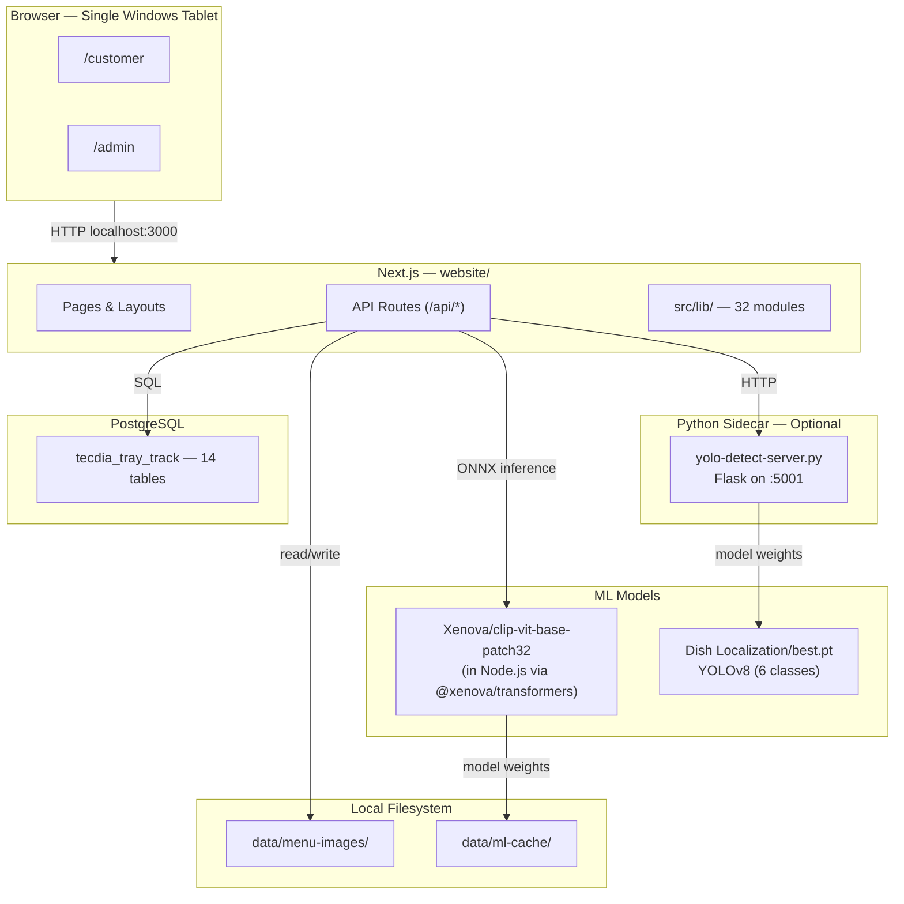
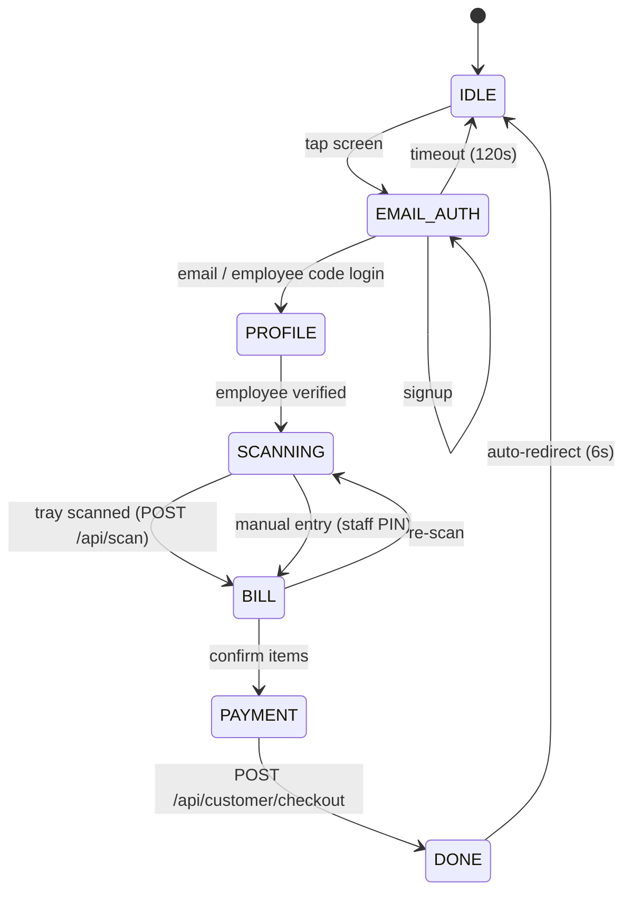
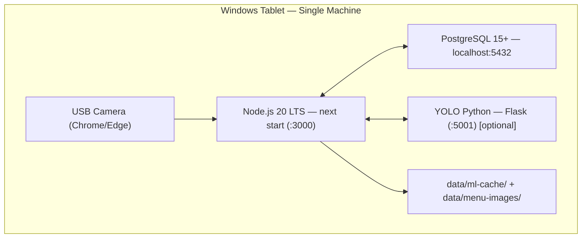

# Tecdia Tray Track — Reference

Cafeteria kiosk: employee login → USB camera tray scan → bill → payment.
Admin manages today's menu and reference photos for on-device dish recognition.

**Deployment guide:** [IMPLEMENTATION.md](./IMPLEMENTATION.md)

---

## Table of Contents

1. [System Architecture](#1-system-architecture)
2. [User Flows](#2-user-flows)
3. [Vision / ML Pipeline](#3-vision--ml-pipeline) — full spec at [VISION_ML_PIPELINE.md](./VISION_ML_PIPELINE.md)
4. [Database Schema](#4-database-schema)
5. [Auth & State Management](#5-auth--state-management)
6. [Architecture Details](#6-architecture-details)
7. [Deployment](#7-deployment)
8. [Tech Stack & Dependencies](#8-tech-stack--dependencies)
9. [API Reference](#9-api-reference) — full spec at [API_REFERENCE.md](./API_REFERENCE.md)
10. [Directory Layout](#10-directory-layout)

---

## 1. System Architecture

### 1.1 High-Level Overview



### 1.2 Architectural Decisions

| Decision | Rationale |
|----------|-----------|
| **Monolithic deploy** | Kiosk runs offline on one machine; no need for microservices |
| **Next.js App Router** | Unified frontend + API, file-based routing, React Server Components |
| **PostgreSQL local** | Zero external dependencies; single-user concurrency |
| **CLIP in Node.js** | Avoids Python for core ML; `@xenova/transformers` runs via ONNX |
| **YOLO as Python sidecar** | `ultralytics` is Python-only; isolated HTTP API on :5001 |
| **Session cookies** | Stateless auth without a separate auth service |
| **Manual SQL migrations** | Simple enough for single-machine deploy |

### 1.3 Module Architecture (src/lib/)

```mermaid
flowchart TB
    subgraph DB_Layer["Database Layer"]
        DB["db.ts"]
        TM["today-menu-db.ts"]
        ED["embeddings-db.ts"]
        EB["embedding-bank.ts"]
        AD["admin-stats-db.ts"]
        AT["admin-transactions-db.ts"]
        AU["admin-users-db.ts"]
        EM["employee-admin-db.ts"]
        CA["customer-activity-db.ts"]
        CP["customer-profile.ts"]
        IS["image-store.ts"]
    end

    subgraph ML_Layer["ML / Vision Layer"]
        CI["clip-embedder.ts"]
        TI["tray-inference.ts"]
        TIC["tray-image-crops.ts"]
        YD["yolo-detector.ts"]
        YM["yolo-service-manager.ts"]
        YRS["yolo-rice-scan.ts"]
        YSS["yolo-sebaw-scan.ts"]
        CVB["computer-vision-bank.ts"]
        VBS["vision-bank-sync.ts"]
        MRR["menu-reference-rebuild.ts"]
        NR["npy-reader.ts"]
    end

    subgraph Auth_Layer["Auth / Session Layer"]
        AUTH["auth.ts"]
        CAUTH["customer-auth.ts"]
        AAUTH["admin-auth.ts"]
        SESS["session.ts"]
    end

    subgraph Business_Layer["Business Logic Layer"]
        MB["manual-bill.ts"]
        DNM["dish-name-match.ts"]
        CONST["constants.ts"]
        UTIL["utils.ts"]
        MOCK["mock-data.ts"]
    end

    DB --> TM & ED & EB & AD & AT & AU & EM & CA & CP & IS
    CI & TIC & YD & YRS & YSS --> TI
    YM --> YD
    CVB & VBS --> EB
    MRR --> CI
    MRR --> IS
    AUTH --> CAUTH & AAUTH
    CONST --> TI & MB
```



**Module rules:**
- API routes import from `src/lib/` only — never from other route files
- `db.ts` is the single PostgreSQL pool; all `-db.ts` modules import from it
- `clip-embedder.ts` is the only module that touches `@xenova/transformers`
- `constants.ts` and `utils.ts` are leaf modules with zero project imports

### 1.4 Component Architecture

```
RootLayout (layout.tsx)
├── MarketingHome (page.tsx)
│   └── MarketingTrayShowcase
├── CustomerLayout (customer/layout.tsx)
│   ├── CustomerFlowProvider (context + reducer)
│   ├── Header
│   ├── CustomerCatCompanion
│   ├── CustomerBackgroundSlideshow
│   └── CustomerInteractivePanel
│       └── KioskPage (customer/page.tsx)
│           ├── IdleScreenEditorial
│           ├── EmailAuthScreen
│           ├── EmployeeIdScanPanel
│           ├── TrayScanView ── ScanOverlay
│           ├── FoodResults ── StaffMenuAddPanel
│           ├── ManualBillingView
│           ├── PaymentScreen
│           ├── FeedbackModal
│           └── DoneScreen
├── AdminLayout (admin/layout.tsx)
│   ├── AdminSidebar
│   └── (page content)
│       ├── AdminLogin (admin/login) ── PinPadModal
│       ├── AdminDashboard (admin) ── StatsGrid
│       ├── AdminMenu (admin/menu) ── MenuEditor + SebawPanel + RicePanel
│       ├── AdminUsers (admin/users) ── UserTable
│       ├── AdminTransactions (admin/transactions) ── TransactionTable
│       ├── AdminFeedbacks (admin/feedbacks) ── FeedbackTable
│       ├── AdminEmployees (admin/employees) ── EmployeeManagementTable
│       └── AdminAnalytics (admin/analytics) ── StatsGrid + inline charts
└── ErrorBoundary (error.tsx) + LoadingFallback (loading.tsx) + NotFound404 (not-found.tsx)
```

| Category | Convention | Examples |
|----------|-----------|---------|
| **UI atoms** | `components/ui/` | `Button`, `Input`, `Card`, `Modal`, `Badge`, `Spinner`, `StatCard`, `PinPadModal` |
| **Layout** | `components/layout/` | `Header`, `AdminSidebar`, `FlowStepper`, `TecdiaLogo`, `CustomerCatCompanion` |
| **Page-specific** | `components/{domain}/` | `components/customer/`, `components/admin/` |
| **Camera** | `components/camera/` | `ScanOverlay` |
| **Marketing** | `components/marketing/` | `MarketingTrayShowcase` |

Patterns: Client components use `"use client"` directive; state via React Context + `useReducer`; no external state library; all UI atoms hand-built with Tailwind CSS.

---

## 2. User Flows

### 2.1 Kiosk Customer Flow (State Machine)

Driven by `useCustomerFlow` (reducer + context in `src/hooks/useCustomerFlow.tsx`).



| Step | Component | Description |
|------|-----------|-------------|
| `IDLE` | `IdleScreenEditorial` | Attract screen, tap to start |
| `EMAIL_AUTH` | `EmailAuthScreen` / `EmployeeIdScanPanel` | Login by email+password or employee code |
| `PROFILE` | — | Loading employee profile + transaction history |
| `SCANNING` | `TrayScanView` + `ScanOverlay` | USB camera → dish recognition |
| `BILL` | `FoodResults` / `ManualBillingView` | Review detected items, adjust quantities |
| `PAYMENT` | `PaymentScreen` | Choose payment method, confirm checkout |
| `DONE` | `DoneScreen` | Receipt shown, auto-reset to IDLE |

**State shape (`CustomerFlowState`):**

```typescript
{
  step: FlowStep;
  employee: Employee | null;
  transactions: Transaction[];
  scannedItems: ScannedItem[];
  billingMode: "scan" | "manual";
  staffBillingAuthorized: boolean;
  paymentMethod: PaymentMethod | null;
  receipt: Receipt | null;
  error: string | null;
  lastScannedEmployeeCode: string | null;
  isLoading: boolean;
}
```

### 2.2 Admin Dashboard

```
Login (/admin/login) → Dashboard → Menu / Users / Transactions / Feedbacks / Employees / Analytics
```

| Page | Component | Key Endpoints |
|------|-----------|---------------|
| Dashboard | `StatsGrid` | `GET /api/admin/stats` |
| Menu | `MenuEditor` + `MenuItemForm` + `SebawPanel` + `RicePanel` | `GET/POST /api/admin/today-menu`, `PATCH/DELETE .../:id`, `GET/POST/DELETE .../image` |
| Users | `UserTable` | `GET/POST /api/admin/users`, `PATCH/DELETE .../:code` |
| Transactions | `TransactionTable` | `GET /api/admin/transactions` |
| Feedbacks | `FeedbackTable` | `GET /api/admin/feedbacks` |
| Employees | `EmployeeManagementTable` | `GET /api/admin/employees`, `PATCH .../:code` |
| Analytics | `StatsGrid` + inline charts | Revenue trends, payment mix, CSV export |

Admin auth: 6-digit PIN → HTTP-only `admin_session` cookie (8-hour expiry). Frontend checks `sessionStorage.admin_auth` flag.

---

## 3. Vision / ML Pipeline

Full pipeline reference with YOLO classes, CLIP matching, failure modes, performance, embedding storage, and env vars: **[VISION_ML_PIPELINE.md](./VISION_ML_PIPELINE.md)**

**Quick summary:**
- YOLO (Python sidecar) localizes tray regions → 6 classes (drink, food, meatless soup, rice_big, rice_small, soup)
- Rice and Sebaw bypass CLIP → direct bill items
- Other regions → CLIP ViT-B/32 encoding → best cosine similarity match (no minimum threshold)
- Embeddings stored in accumulating `menu_item_embedding_bank` (all time) + `menu_item_day_embeddings` (today)
- Auto-sync from Computer Vision folder `.npy` files on each scan
- 7 distinct failure modes with user-facing messages

---

## 4. Database Schema

Full schema reference with column-level detail, indexes, foreign keys, migration history, and query patterns: **[DATABASE_SCHEMA.md](./DATABASE_SCHEMA.md)**

**Quick facts:**

| Detail | Value |
|--------|-------|
| Engine | PostgreSQL 15+ |
| Database | `tecdia_tray_track` |
| Extension | `pgcrypto` (`gen_random_uuid()`) |
| Tables | 14 |
| Indexes | 16 |
| Foreign keys | 15 |
| Migrations | 9 incremental (002–010) |

---

## 5. Auth & State Management

### 5.1 Customer Auth

```
Signup:  POST /api/auth/signup      → hash(password) + salt → INSERT → Set-Cookie
Login:   POST /api/auth/login       → verify hash → Set-Cookie
Code:    POST /api/auth/login-by-employee-code → lookup → Set-Cookie
Me:      GET  /api/auth/me          → read cookie → return customer
Logout:  POST /api/auth/logout      → clear cookie
```

Passwords hashed with random salt (`auth.ts`). Session stored as HTTP-only `CUSTOMER_SESSION_COOKIE`. No JWT.

### 5.2 Admin Auth

- 6-digit PIN from `.env.local`: `ADMIN_PIN` (full access) + `CASHIER_PIN` (billing only)
- `POST /api/admin/login` → validate → set `admin_session` cookie (8-hour HTTP-only)
- Frontend: `AdminLayout` checks `sessionStorage.admin_auth` → redirect to `/admin/login` if missing

### 5.3 State Management

| Storage | What | Why |
|---------|------|-----|
| `CUSTOMER_SESSION_COOKIE` (HTTP-only) | Auth token for API calls | XSS protection |
| `sessionStorage.admin_auth` | Admin UI flag | Quick client check; server validates cookie |

Flow transitions enforced by the reducer (`customerFlowReducer`), not by components.

---

## 6. Architecture Details

### 6.1 Error Handling

**API layer** — all routes return consistent shape:
```typescript
{ ok: boolean; data?: T; error?: string }
```

**UI layer** — `error.tsx` (global boundary), `CustomerFlowState.error` (per-step), `FeedbackModal` (user reports).

### 6.2 Configuration

```
.env.example → .env.local → process.env → getDbPool(), constants.ts, etc.
```

All env vars read at process startup. Groups:

| Group | Variables | Read By |
|-------|-----------|---------|
| Database | `POSTGRES_*` | `db.ts` |
| Auth | `AUTH_SESSION_SECRET`, `ADMIN_PIN`, `CASHIER_PIN` | `session.ts`, `admin-auth.ts` |
| ML Mode | `ML_INFERENCE_MODE` | `constants.ts` (threshold env vars deprecated — see [VISION_ML_PIPELINE.md](./VISION_ML_PIPELINE.md) §6) |
| ML Model | `ML_MODEL_*`, `MENU_IMAGES_DIR` | `clip-embedder.ts`, `image-store.ts` |
| YOLO | `ML_YOLO_*` | `yolo-detector.ts`, `yolo-service-manager.ts` |

### 6.3 Service Layer

**YOLO Service Manager** (`yolo-service-manager.ts`): auto-starts Python Flask sidecar on first scan. Full auto-start sequence and failure modes in [VISION_ML_PIPELINE.md](./VISION_ML_PIPELINE.md) §2.3–2.4.

**Image Store** (`image-store.ts`):
- `saveImageFile(buffer, id)` → `data/menu-images/{id}.jpg`
- `getImageFile(id)` → Buffer
- `deleteImageFile(id)` → remove file
- `imageExists(id)` → boolean

### 6.4 Security

| Concern | Implementation |
|---------|---------------|
| PIN verification | Server-side only |
| Session hijacking | HTTP-only cookies; Secure flag in production |
| Password storage | Custom hash + salt (`auth.ts`) |
| Database | Localhost-only; no network exposure |
| File upload | JPEG only; no user-controlled filenames |
| ML model | Local ONNX weights; no external API calls |

**Known gaps:** Admin API routes lack consistent server-side auth middleware; no rate limiting on login; no CSRF protection; custom hashing (not bcrypt/argon2).

---

## 7. Deployment

### 7.1 Deployment Diagram



### 7.2 Start-up Sequence

1. Windows boots → PostgreSQL starts (Windows service)
2. Task Scheduler → `npm run start` in `website/`
3. Optional: Task Scheduler → `python scripts/yolo-detect-server.py`
4. Chrome kiosk mode → `http://localhost:3000/customer`

### 7.3 Build Flow

```
npm install → npm run ml:setup (download CLIP) → npm run build
   ↓
Copy .next/ + node_modules/ + data/ml-cache/ + .env.local to tablet
   ↓
psql migrations → npm run start
```

### 7.4 Non-Functional Characteristics

| Aspect | Detail |
|--------|--------|
| Single-user | One concurrent kiosk session at a time |
| Offline-capable | No internet once `.env.local` + `data/ml-cache` are set up |
| First scan | ~30-60s (CLIP warm-up); sub-second thereafter (see [VISION_ML_PIPELINE.md](./VISION_ML_PIPELINE.md) §5) |
| Subsequent scans | ~2-5s (YOLO + CLIP + matching) |
| RAM | ~500 MB Node.js, ~1 GB PostgreSQL, ~500 MB CLIP |

### 7.5 Hardware Requirements

| Component | Minimum | Recommended |
|-----------|---------|-------------|
| OS | Windows 10 | Windows 11 |
| RAM | 8 GB | 16 GB |
| Disk | 2 GB free | 5 GB free |
| CPU | x86_64, 4 cores | x86_64, 8+ cores |
| Camera | USB webcam (720p) | USB webcam (1080p) |
| Browser | Chrome / Edge | Chrome / Edge (latest) |

**Disk breakdown:** `node_modules/` ~500 MB, `.next/` ~200 MB, `data/ml-cache/` ~400 MB, `data/menu-images/` ~10-50 MB, Python venv ~1-2 GB.

---

## 8. Tech Stack & Dependencies

### 8.1 Runtime Overview

| Layer | Technology | Version |
|-------|-----------|---------|
| Framework | Next.js | ^16.2.6 |
| UI | React | 19.2.4 |
| Language | TypeScript | ^6.0.2 |
| Styling | Tailwind CSS | ^4 |
| Database | PostgreSQL | 15+ |
| ML (Node) | `@xenova/transformers` | ^2.17.2 |
| ML (Python) | `ultralytics` | — |
| Python Server | Flask + waitress | — |

### 8.2 Node.js Dependencies (from `website/package.json`)

| Package | Version | Used In | Purpose |
|---------|---------|---------|---------|
| `next` | ^16.2.6 | Entire app | Framework (routing, SSR, API, build) |
| `react` | 19.2.4 | All components | UI rendering |
| `react-dom` | 19.2.4 | All components | DOM rendering |
| `@xenova/transformers` | ^2.17.2 | `clip-embedder.ts` | CLIP ViT-B/32 inference |
| `pg` | ^8.20.0 | `db.ts` + `-db.ts` modules | PostgreSQL client |
| `sharp` | ^0.34.5 | `tray-image-crops.ts`, `image-store.ts` | JPEG processing |
| `jimp` | ^1.6.1 | `tray-image-crops.ts` | Fallback image processing |

| Dev Package | Version | Purpose |
|-------------|---------|---------|
| `typescript` | ^6.0.2 | Type checking |
| `tsx` | ^4.22.0 | TS script execution |
| `eslint` + `eslint-config-next` | ^9 / 16.2.3 | Linting |
| `tailwindcss` + `@tailwindcss/postcss` | ^4 | Styling |
| `@types/*` | various | Type definitions |

**Key scripts:**

| Script | Purpose |
|--------|---------|
| `npm run dev` | Development server (webpack) |
| `npm run dev:ml` | Dev + auto-start YOLO |
| `npm run yolo` | Start YOLO Flask server |
| `npm run build` | Production build |
| `npm run start` | Production server |
| `npm run lint` | ESLint |
| `npm run ml:setup` | Download CLIP weights to cache |
| `npm run ml:import-vision` | Import vision bank prototypes |

### 8.3 Python Dependencies

**YOLO server** (`website/scripts/yolo-detect-server.py`): `ultralytics`, `flask`, `waitress`, `opencv-python-headless`, `numpy`

Install: `pip install ultralytics flask opencv-python-headless waitress`

**Optional training scripts** (`dish classification/scripts/`):

| Script | Libraries | Purpose |
|--------|-----------|---------|
| `train_detector.py` | `ultralytics` | Train YOLOv8 |
| `build_embeddings.py` | `open-clip-torch`, `torch`, `PIL`, `numpy` | Build CLIP embedding bank |
| `predict_dish.py` | `ultralytics`, `open-clip-torch`, `sklearn`, `cv2` | End-to-end test |
| `test_detetctor.py` | `ultralytics` | Quick YOLO test |

### 8.4 Key Library Details

**`@xenova/transformers` (CLIP):**
- Model: `Xenova/clip-vit-base-patch32`
- Runs in Node.js via ONNX (no Python)
- Cache: `data/ml-cache/` (~400 MB)
- First load: ~30-60s; subsequent: ~500ms-2s per embedding
- Output: 512-dim normalized vector

**`ultralytics` (YOLO):**
- Model: `Dish Localization/best.pt` (YOLOv8)
- 6 classes (see [VISION_ML_PIPELINE.md](./VISION_ML_PIPELINE.md) §2.2)
- Runs as separate Python process on :5001

**`pg` (node-postgres):**
- Connection pool in `db.ts` — max 10, idle timeout 30s, connection timeout 5s

**`sharp` + `jimp`:** primary + fallback image processors.

### 8.5 System Dependencies

| Tool | Purpose |
|------|---------|
| Node.js 20 LTS | App runtime |
| PostgreSQL 15+ | Database |
| Python 3.10+ | YOLO service + training |
| `psql` / `pg_dump` | Database management |

---

## 9. API Reference

Full endpoint reference with request/response shapes, cookie details, and shared types: **[API_REFERENCE.md](./API_REFERENCE.md)**

**Quick summary — 40 endpoints:**

| # | Method | Route | Purpose |
|---|--------|-------|---------|
| 1 | GET | `/api/health` | Server health |
| 2 | GET | `/api/ml/status` | ML health |
| 3 | POST | `/api/scan` | Tray image → ScannedItem[] (multipart) |
| 4 | GET | `/api/menu/today` | Today's menu (public) |
| 5 | POST | `/api/auth/login` | Customer email+password login |
| 6 | POST | `/api/auth/login-by-employee-code` | Login by employee code only |
| 7 | POST | `/api/auth/signup` | Register new customer |
| 8 | POST | `/api/auth/logout` | Clear customer session |
| 9 | GET | `/api/auth/me` | Current customer from session |
| 10 | POST | `/api/auth/reset-password` | Admin-reset password |
| 11 | POST | `/api/auth/verify-super-pin` | Validate admin PIN |
| 12 | GET | `/api/customer/profile` | Employee profile + balance |
| 13 | GET | `/api/customer/transactions` | Transaction history |
| 14 | POST | `/api/customer/checkout` | Complete purchase |
| 15 | POST | `/api/customer/feedback` | Submit issue report |
| 16 | GET | `/api/customer/employees/[employeeCode]` | Employee lookup |
| 17 | POST | `/api/admin/login` | Admin PIN login |
| 18 | POST | `/api/admin/logout` | Clear admin session |
| 19 | GET | `/api/admin/stats` | Dashboard statistics |
| 20 | GET | `/api/admin/users` | List staff users |
| 21 | POST | `/api/admin/users` | Create staff user |
| 22 | PATCH | `/api/admin/users/[userCode]` | Update staff user |
| 23 | DELETE | `/api/admin/users/[userCode]` | Delete staff user |
| 24 | GET | `/api/admin/today-menu` | Today's menu (admin, enriched) |
| 25 | POST | `/api/admin/today-menu` | Add menu item |
| 26 | PATCH | `/api/admin/today-menu/[menuItemId]` | Update menu item |
| 27 | DELETE | `/api/admin/today-menu/[menuItemId]` | Remove menu item |
| 28 | PUT | `/api/admin/today-menu/sebaw` | Toggle Sebaw availability |
| 29 | PUT | `/api/admin/today-menu/rice` | Set rice prices |
| 30 | GET | `/api/admin/today-menu/[menuItemId]/image` | Serve reference image |
| 31 | POST | `/api/admin/today-menu/[menuItemId]/image` | Upload photo + embed |
| 32 | DELETE | `/api/admin/today-menu/[menuItemId]/image` | Remove photo + embedding |
| 33 | GET | `/api/admin/transactions` | All transactions |
| 34 | GET | `/api/admin/feedbacks` | All feedback submissions |
| 35 | GET | `/api/admin/employees` | All employees |
| 36 | PATCH | `/api/admin/employees/[employeeCode]` | Update employee |
| 37 | POST | `/api/admin/ml/rebuild-references` | Rebuild CLIP embeddings |
| 38 | POST | `/api/admin/ml/import-vision` | Import vision bank prototypes |
| 39 | GET | `/api` | API info |
| 40 | POST | `/api` | Echo body |

---

## 10. Directory Layout

```
website/                          ← Next.js app
├── src/
│   ├── app/                      ← App Router
│   │   ├── page.tsx              ← Marketing homepage
│   │   ├── layout.tsx            ← Root layout
│   │   ├── customer/             ← Kiosk SPA
│   │   ├── admin/                ← 7 admin sub-pages
│   │   └── api/                  ← 38 API route files
│   ├── components/
│   │   ├── admin/                ← 9 components
│   │   ├── camera/               ← ScanOverlay
│   │   ├── customer/             ← 10 components
│   │   ├── layout/               ← 7 components
│   │   ├── marketing/            ← MarketingTrayShowcase
│   │   └── ui/                   ← 9 atoms (Button, Input, Card, etc.)
│   ├── hooks/                    ← useCustomerFlow, useCamera, useEmployeeIdScanner
│   ├── lib/                      ← 32 modules (business + ML logic)
│   ├── services/                 ← api.ts (frontend API client)
│   └── types/                    ← index.ts (shared TypeScript types)
├── scripts/                      ← Node.js + Python utilities
├── db/
│   ├── schema.sql
│   ├── migrations/               ← 9 incremental SQL migrations
│   └── seed_today_menu_example.sql
├── data/                         ← runtime (gitignored)
│   ├── ml-cache/                 ← CLIP model weights
│   └── menu-images/              ← Reference photos

Dish Localization/                ← YOLO model (best.pt + notebook)
dish classification/              ← Python training scripts (optional)
docs/
├── IMPLEMENTATION.md             ← Deployment guide
├── REFERENCE.md                  ← This document
├── API_REFERENCE.md              ← Full endpoint specs
├── DATABASE_SCHEMA.md            ← Column-level schema, indexes, FKs
└── VISION_ML_PIPELINE.md         ← ML pipeline, thresholds, failure modes
```
