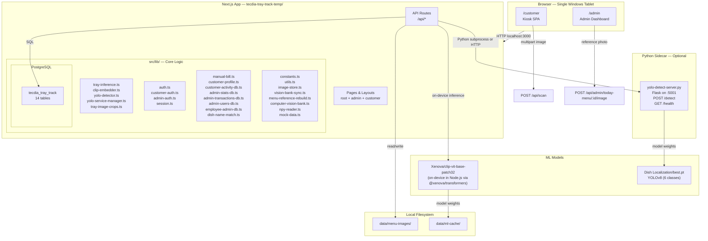
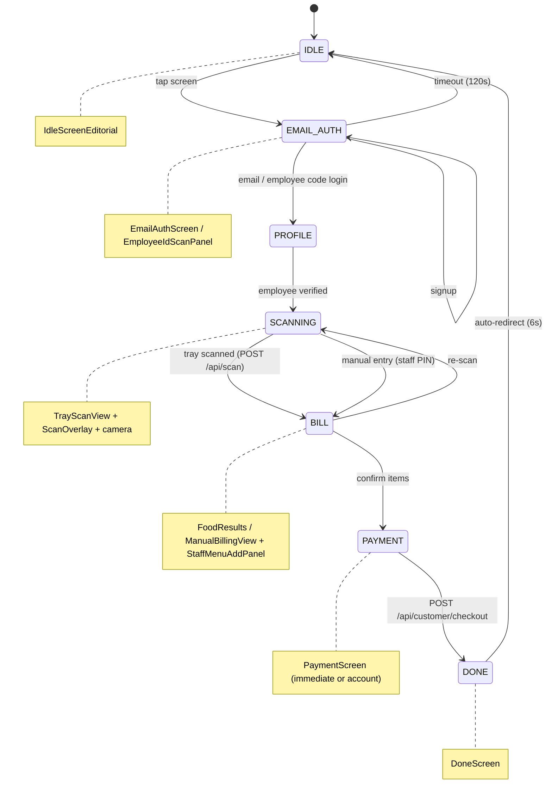
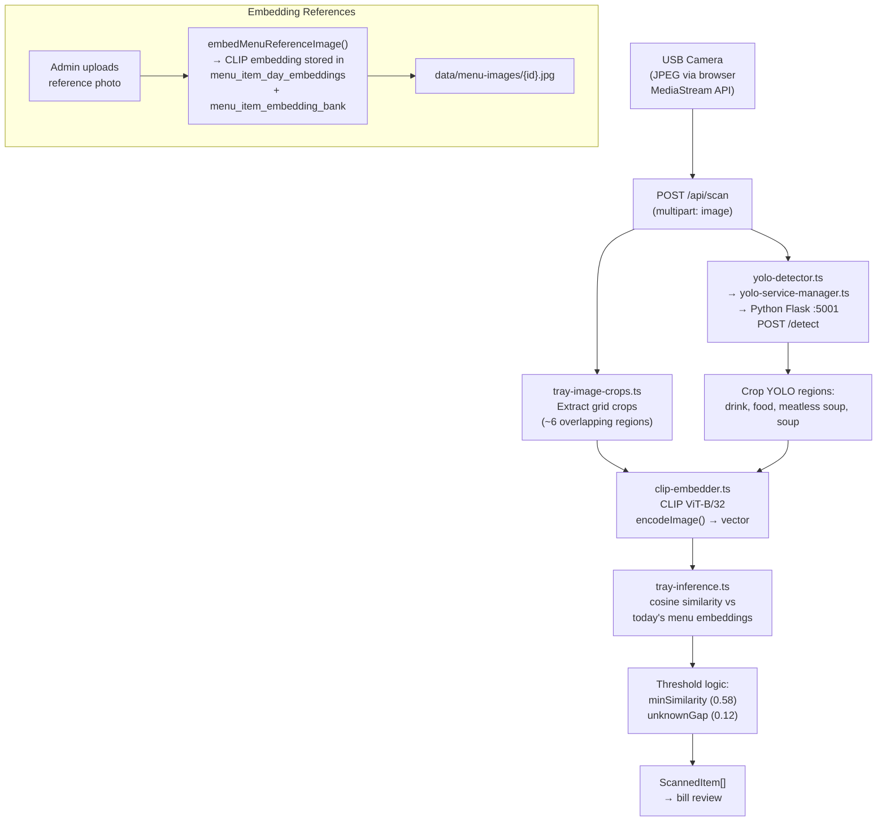
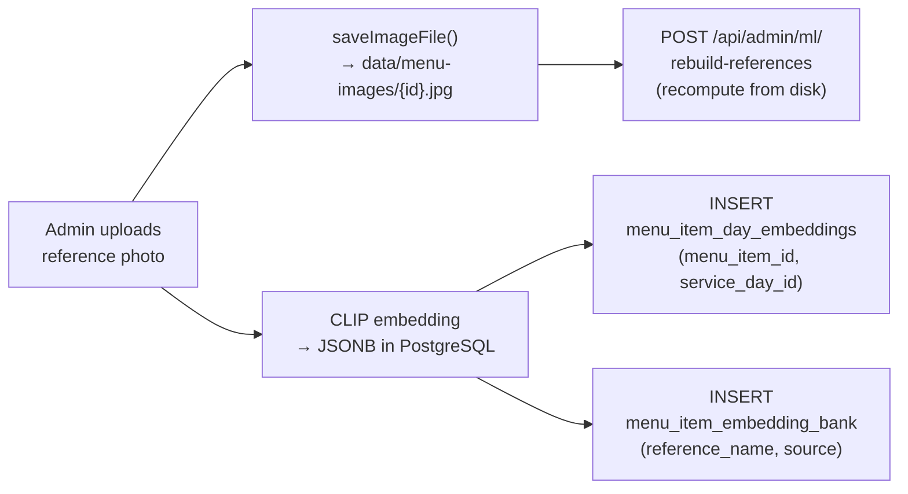
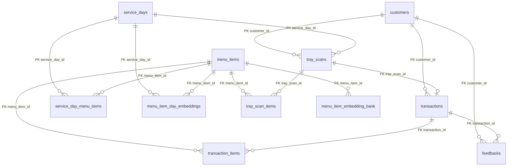
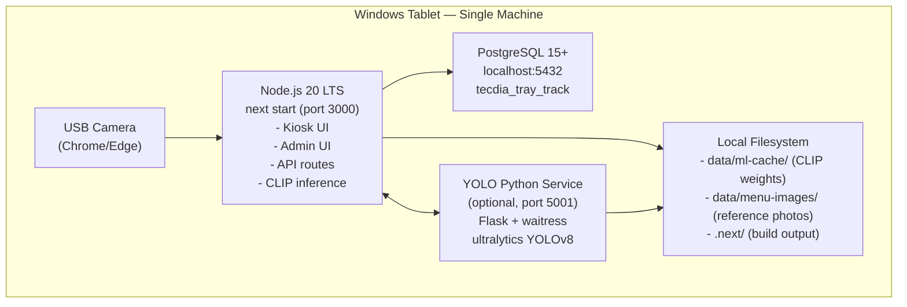

# System Design — Tecdia Tray Track

Cafeteria kiosk: employee login → USB camera tray scan → bill → payment.
Admin manages today's menu and reference photos for on-device dish recognition.

---

## 1. High-Level Architecture



---

## 2. Kiosk Customer Flow (State Machine)

The kiosk is a single-page state machine driven by `useCustomerFlow` (reducer + context in `src/hooks/useCustomerFlow.tsx`).



### Flow Steps

| Step | Component | Description |
|------|-----------|-------------|
| `IDLE` | `IdleScreenEditorial` | Attract screen, tap to start |
| `EMAIL_AUTH` | `EmailAuthScreen` | Login by email+password or employee code |
| `PROFILE` | — | Loading employee profile + transaction history |
| `SCANNING` | `TrayScanView` + `ScanOverlay` | USB camera → grid/YOLO → dish recognition |
| `BILL` | `FoodResults` | Review detected items, adjust quantities |
| `PAYMENT` | `PaymentScreen` | Choose payment method, confirm checkout |
| `DONE` | `DoneScreen` | Receipt shown, auto-reset to IDLE |

### State Shape (`CustomerFlowState`)

```typescript
{
  step: FlowStep;
  employee: Employee | null;
  transactions: Transaction[];
  scannedItems: ScannedItem[];
  billingMode: "scan" | "manual";
  staffBillingAuthorized: boolean;
  paymentMethod: PaymentMethod | null;
  receipt: Receipt | null;
  error: string | null;
  lastScannedEmployeeCode: string | null;
  isLoading: boolean;
}
```

---

## 3. Admin Dashboard

### Route Structure

```mermaid
flowchart LR
    subgraph Admin[Admin SPA]
        Login["/admin/login
PIN Login"]
        Dashboard["/admin
Stats Grid"]
        Menu["/admin/menu
Menu Editor (CRUD + photos)"]
        Users["/admin/users
User Management"]
        Transactions["/admin/transactions
Transaction History"]
        Feedbacks["/admin/feedbacks
Customer Feedback"]
        Employees["/admin/employees
Employee Registry"]
        Analytics["/admin/analytics
Charts + Reports"]
    end

    Login --> Dashboard: correct PIN
    Dashboard --> Menu
    Dashboard --> Users
    Dashboard --> Transactions
    Dashboard --> Feedbacks
    Dashboard --> Employees
    Dashboard --> Analytics
```

### Admin Components

| Admin Page | Component | Key Endpoints Used |
|-----------|-----------|-------------------|
| Dashboard | `StatsGrid` | `GET /api/admin/stats` |
| Menu | `MenuEditor` + `MenuItemForm` + `SebawPanel` + `RicePanel` | `GET/POST /api/admin/today-menu`, `PATCH/DELETE /api/admin/today-menu/:id`, `GET/POST/DELETE .../image` |
| Users | `UserTable` | `GET/POST /api/admin/users`, `PATCH/DELETE /api/admin/users/:code` |
| Transactions | `TransactionTable` | `GET /api/admin/transactions` |
| Feedbacks | `FeedbackTable` | `GET /api/admin/feedbacks` |
| Employees | `EmployeeManagementTable` | `GET /api/admin/employees`, `PATCH /api/admin/employees/:code` |
| Analytics | `StatsGrid` + inline charts | revenue trends, payment mix, sales breakdown, CSV export |
| Login | `PinPadModal` | `POST /api/admin/login`, `POST /api/admin/logout` |

Admin auth: 6-digit PIN → HTTP-only `admin_session` cookie (8-hour expiry). Frontend checks `sessionStorage` for `admin_auth` flag.

---

## 4. Vision / ML Pipeline

### Tray Scan Pipeline



### Detection Classes (YOLO — `best.pt`)

```
0: drink
1: food
2: meatless soup
3: rice_big       ← auto-charged, no CLIP needed
4: rice_small     ← auto-charged, no CLIP needed
5: soup
```

- `rice_big` / `rice_small`: billed by quantity detected, no CLIP matching
- `drink`, `food`, `meatless soup`, `soup`: crops sent to CLIP for dish identification
- `meatless soup` + category "Soup" + name "Sebaw" = free soup (special handling)

### Similarity Matching Logic (`tray-inference.ts`)

```
For each CLIP crop:
  1. Compute embedding vector
  2. Cosine similarity vs all today-menu embeddings
  3. Best match → score
  4. If best match is NOT in today's menu:
     - Find best menu match
     - If menu match score > minSimilarity (0.58)
       AND score gap < unknownGap (0.12)
       → use menu match
     - Else → mark as "UNKNOWN"
  5. Deduplicate: multiple detections of same dish → single ScannedItem
```

### Reference Photo Flow



---

## 5. Database Schema (ERD)

### Tables & Relationships



### 14 Tables Summary

| Table | Purpose | Key Columns |
|-------|---------|-------------|
| `customers` | Employee accounts (email + password auth) | `employee_code`, `email`, `full_name`, `password_hash`, `salt` |
| `admin_users` | Hard-coded (not used in kiosk UI) | `email`, `pin_hash` |
| `staff_users` | Admin/cashier access control | `user_code`, `role` (admin/cashier), `status` |
| `menu_items` | Master dish catalog | `code`, `name`, `category`, `base_price`, `reference_embedding` |
| `service_days` | Service date groupings | `service_date` (unique), `meal_window` |
| `service_day_menu_items` | Which dishes are on today's menu | `override_price`, `available`, FK to service_days + menu_items |
| `tray_scans` | Scan sessions | `status`, `scan_source`, FK to customer + service_day |
| `tray_scan_items` | Individual detections per scan | `quantity`, `unit_price`, `confidence`, FK to tray_scan + menu_item |
| `transactions` | Payment records | `subtotal`, `total_amount`, `payment_method`, `status` |
| `transaction_items` | Line items per transaction | `item_name_snapshot`, `quantity`, `unit_price`, `line_total` |
| `feedbacks` | Customer issue reports | `issue_text`, FK to customer + transaction |
| `menu_item_day_embeddings` | CLIP vectors for today's menu | `embedding` (JSONB), `model_version`, FK to menu_item + service_day |
| `menu_item_embedding_bank` | All known dish prototypes | `embedding` (JSONB), `reference_name`, `source`, `source_key` |
| `embedding_bank_sync_state` | Sync tracking for vision bank | `source`, `fingerprint`, `prototype_count` |

---

## 6. Deployment Architecture



### Startup Sequence

1. PostgreSQL starts (Windows service, auto-start)
2. `npm run start` → Next.js serves on `:3000`
3. On first `/api/scan` → CLIP model loads from cache (~400 MB, ~30-60s)
4. Optional: `python scripts/yolo-detect-server.py` → Flask on `:5001`

### Non-Functional Characteristics

| Aspect | Detail |
|--------|--------|
| **Single-user** | One concurrent kiosk session at a time |
| **Offline-capable** | No internet once `.env.local` + `data/ml-cache` are set up |
| **First-scan latency** | ~30-60s for CLIP warm-up; sub-second thereafter |
| **Subsequent scans** | ~2-5s (grid crops + CLIP encode + similarity search) |
| **RAM** | ~500 MB for Node.js, ~1 GB for PostgreSQL, ~500 MB for CLIP |

---

## 7. Key Data Flows

### A. Morning Setup (Admin)

```
Admin logs in (6-digit PIN)
  ↓
Navigates to Menu Editor
  ↓
For each dish served today:
  1. Add/Edit menu item (name, category, price, calories)
  2. Upload reference photo (JPEG from tablet camera or file)
  3. Server saves to data/menu-images/{id}.jpg
  4. Server runs CLIP embedding → stored in:
     - menu_item_day_embeddings (for today's matching)
     - menu_item_embedding_bank (permanent prototype bank)
  ↓
Verify: /api/ml/status → todayEmbeddingCount > 0
```

### B. Kiosk Transaction

```
Customer approaches kiosk (IDLE screen)
  ↓ Tap screen
Customer logs in (EMAIL_AUTH):
  - Option A: Enter employee code (scanned from ID card)
  - Option B: Email + password
  ↓
Employee profile loaded (PROFILE)
  ↓
Tray placed under USB camera
  ↓ Camera opens in browser
Server processes tray image (SCANNING):
  ├── Grid crop approach: 6 overlapping regions → CLIP → embeddings
  ├── YOLO approach (if enabled): POST /detect → extract regions → CLIP
  └── Match vs today's embeddings → ScannedItem[]
  ↓
Bill shown to customer (BILL):
  - Detected items with prices
  - Cashier PIN can adjust/add items
  ↓
Payment selected (PAYMENT):
  - "immediate" → charge now
  - "account" → deduct from account balance
  ↓
POST /api/customer/checkout → Transaction created
  ↓
Receipt shown (DONE) → redirect to IDLE after 6s
```

### C. Reference Image → Embedding Persistence

```
Admin uploads photo
  ↓
src/lib/image-store.ts → saves JPEG to disk
  ↓
src/lib/clip-embedder.ts → compute CLIP vector
  ↓
src/lib/embeddings-db.ts → INSERT menu_item_day_embeddings
  +                                     embedding_bank
  ↓
src/lib/menu-reference-rebuild.ts → batch recompute from disk
```

---

## 8. API Route Map

```
/api
├── /health                          GET    Health check
├── /scan                            POST   Tray image → dish recognition
├── /ml/status                       GET    ML model health + embedding count
├── /menu/today                      GET    Today's menu items (public)
├── /auth
│   ├── /login                       POST   Customer email+password login
│   ├── /login-by-employee-code      POST   Customer employee-code login
│   ├── /signup                      POST   Register new customer
│   ├── /logout                      POST   Clear customer session
│   ├── /me                          GET    Current customer from session
│   ├── /reset-password              POST   Admin-reset customer password
│   └── /verify-super-pin            POST   Validate admin PIN
├── /customer
│   ├── /profile                     GET    Employee profile + balance
│   ├── /transactions                GET    Customer transaction history
│   ├── /checkout                    POST   Complete purchase
│   ├── /feedback                    POST   Submit issue report
│   └── /employees/[employeeCode]    GET    Employee lookup
├── /admin
│   ├── /login                       POST   Admin PIN login → session cookie
│   ├── /logout                      POST   Clear admin session
│   ├── /stats                       GET    Dashboard statistics
│   ├── /users                       GET    List staff users
│   │                                POST   Create staff user
│   ├── /users/[userCode]            PATCH  Update staff user
│   │                                DELETE Delete staff user
│   ├── /today-menu                  GET    List today's menu (admin)
│   │                                POST   Add menu item
│   ├── /today-menu/sebaw            PUT    Toggle Sebaw availability
│   ├── /today-menu/rice             PUT    Set rice prices
│   ├── /today-menu/[menuItemId]     PATCH  Update menu item
│   │                                DELETE Remove menu item
│   ├── /today-menu/[menuItemId]/image GET   Serve reference image
│   │                                POST   Upload reference photo + embed
│   │                                DELETE Remove photo + embedding
│   ├── /transactions                GET    All transactions
│   ├── /feedbacks                   GET    All feedback submissions
│   ├── /employees                   GET    All employees
│   ├── /employees/[employeeCode]    PATCH  Update employee profile
│   └── /ml
│       ├── /rebuild-references      POST   Recompute CLIP embeddings from disk
│       └── /import-vision           POST   Import vision bank prototypes
```

Full details in [API_REFERENCE.md](./API_REFERENCE.md).

---

## 9. Directory Layout

```
tecdia-tray-track-temp/          ← website/ (Next.js app)
├── src/
│   ├── app/                     ← Next.js App Router (pages + API)
│   │   ├── page.tsx             ← Marketing homepage
│   │   ├── layout.tsx           ← Root layout (fonts, HTML)
│   │   ├── customer/            ← Kiosk SPA
│   │   ├── admin/               ← Admin dashboard (7 sub-pages)
│   │   └── api/                 ← 33 API routes
│   ├── components/
│   │   ├── admin/               ← 9 admin components
│   │   ├── camera/              ← ScanOverlay
│   │   ├── customer/            ← 10 kiosk step components
│   │   ├── layout/              ← 7 layout components
│   │   ├── marketing/           ← MarketingTrayShowcase
│   │   └── ui/                  ← 9 reusable atomics
│   ├── hooks/                   ← useCustomerFlow, useCamera, useEmployeeIdScanner
│   ├── lib/                     ← 32 modules (core business + ML logic)
│   ├── services/                ← API client (api.ts)
│   └── types/                   ← Shared TypeScript types
├── scripts/                     ← Node.js + Python utility scripts
├── db/
│   ├── schema.sql               ← Full schema
│   ├── migrations/              ← 9 incremental migrations
│   └── seed_today_menu_example.sql
├── data/                        ← Runtime data (gitignored)
│   ├── ml-cache/                ← CLIP model weights
│   └── menu-images/             ← Reference photos

Dish Localization/               ← YOLO model (best.pt + training notebook)
dish classification/             ← Python training scripts (optional)
docs/
├── IMPLEMENTATION.md            ← Deployment guide
└── SYSTEM_DESIGN.md             ← This document
```

---

## 10. Tech Stack Summary

| Layer | Technology | Purpose |
|-------|-----------|---------|
| **Framework** | Next.js 16 (App Router) | Full-stack React framework |
| **Frontend** | React 19 + TypeScript 6 | UI + state management |
| **Styling** | Tailwind CSS 4 | Utility-first CSS |
| **Database** | PostgreSQL 15+ | Relational data store |
| **DB Driver** | `pg` (node-postgres) | PostgreSQL client |
| **ML — CLIP** | `@xenova/transformers` | On-device vision-language model |
| **ML — YOLO** | `ultralytics` (Python) | Dish region detection |
| **Images** | `sharp` + `jimp` | JPEG processing in Node |
| **Python Server** | Flask + waitress | YOLO HTTP sidecar |
| **Auth** | Custom PIN + bcrypt-like hashing | Session cookies (admin + customer) |

Full dependency list in [TECH_STACK.md](./TECH_STACK.md).
